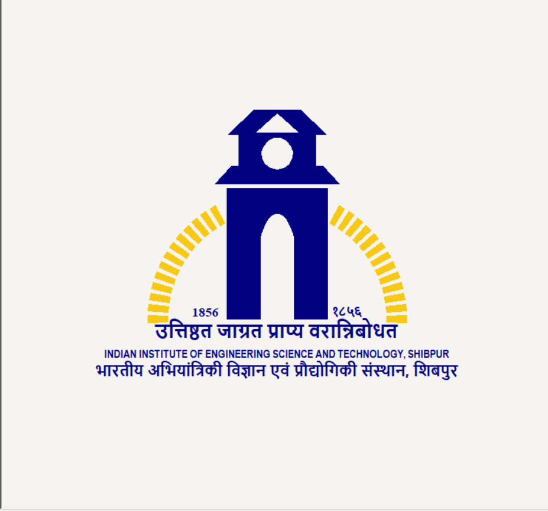

# 🏛️ IIEST Shibpur Logo | Python Turtle Graphics

A creative Python project that recreates the emblem of **Indian Institute of Engineering Science and Technology (IIEST), Shibpur** using the Turtle Graphics library.

The project explores how mathematical concepts, geometric shapes and programming logic can be combined to generate a detailed institutional emblem entirely through code.

## 🖼️ Project Preview



## 🎥 Demonstration

Watch the screen recording of the logo being generated step by step: [View Project Demo](assets/demo.mp4)

## 🛠️ Technologies Used

- **Python 3** – Core programming language.
- **Turtle Graphics** – Drawing and visualisation.
- **Math Module** – Trigonometric calculations and coordinate generation.

## ⚙️ Concepts Implemented

- **Coordinate Geometry:** Positioning graphical elements using Cartesian coordinates.
- **Trigonometry:** Using sine and cosine functions to generate the semicircular sunburst pattern.
- **Functions:** Breaking the drawing process into reusable functions.
- **Loops:** Automating repetitive geometric patterns.
- **Polygon Construction:** Creating complex shapes using custom coordinate points.
- **Layered Rendering:** Drawing individual components in a specific order to construct the final emblem.
- **Text Rendering:** Integrating multilingual text using different font configurations.

## 🚀 How to Run

1. Install Python 3 on your system.
2. Clone this repository:

   ```bash
   git clone https://github.com/YOUR-USERNAME/iiest-shibpur-logo-turtle.git
   ```

3. Navigate to the project directory:

   ```bash
   cd iiest-shibpur-logo-turtle
   ```

4. Run the Python script:

   ```bash
   python main.py
   ```

**Requirements:** Python 3 with the standard `turtle` and `math` libraries. A graphical desktop environment is required.

## 📚 Learning Takeaways

This project helped me understand how mathematical principles can translate into visual programming. I explored trigonometric coordinate generation, geometric transformations, modular programming and graphical rendering while experimenting with Python Turtle.

It was a practical exercise in combining **mathematics, logic and creativity through programming.**

## 👨‍💻 Author

Created as a personal programming experiment at IIEST Shibpur.

---

*An independent graphical recreation for educational purposes; not an official institutional logo asset.*
